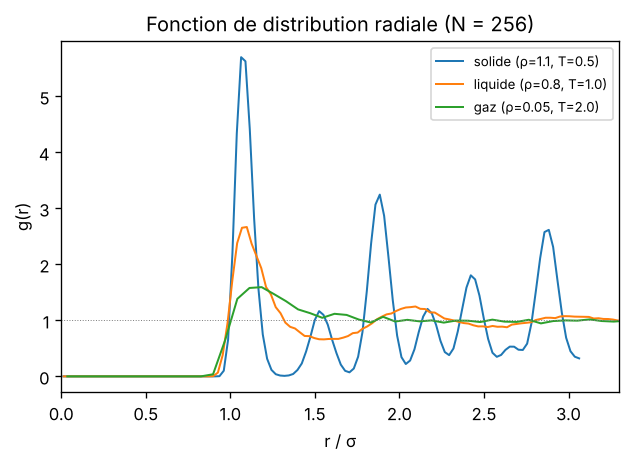
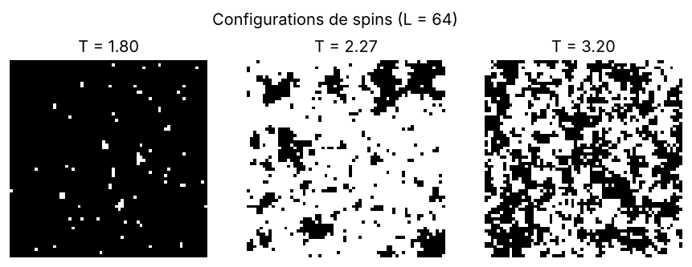

<div align="center">

# Ismaila AMADOU DEH · Simulation numérique & physique des matériaux

**Master 2 Physique Fondamentale, parcours Théories Quantiques (QAT) · Université de Tours · Institut Denis Poisson (CNRS UMR 7013)**

🎯 **Je recherche un stage de M2 en simulation atomistique / physique des matériaux** : dynamique moléculaire, potentiels interatomiques, quantification d'incertitude.

      

[🌐 Portfolio](https://ismailadeh.github.io/Ismaila/) · [📄 Portfolio PDF](cv/portfolio.pdf) · [💼 LinkedIn](https://www.linkedin.com/in/ismaila-amadou-deh) · [🐙 GitHub](https://github.com/IsmailaDEH)

</div>

---

## 📈 En chiffres

| **8** projets | **34** tests automatiques | **256** atomes simulés en dynamique moléculaire | **0,9 %** d'erreur sur T_c (Ising) | **60σ** de violation de Bell simulée |
|---|---|---|---|---|

## ⭐ Projets phares pour la simulation des matériaux

| # | Projet | Ce qu'il montre | Résultat clé |
|---|---|---|---|
| 06 | [⚛️ Dynamique moléculaire de l'argon](projets/06-dynamique-moleculaire-lennard-jones) | Verlet, conditions périodiques, thermostat, viriel, g(r), diffusion | 3 phases reproduites ; D(liquide) ≈ 3,5 × 10⁻⁵ cm²/s ; énergie conservée à l'ordre dt² |
| 07 | [📉 Potentiel interatomique appris + incertitude](projets/07-potentiel-interatomique-incertitude) | Processus gaussien, propagation d'incertitude, apprentissage actif | r_e(H₂) = 0,7400 ± 0,0021 Å (vrai : 0,7414) ; erreur de forme d'un modèle rigide mise en évidence |
| 02 | [🧲 Modèle d'Ising 2D par Monte-Carlo](projets/02-modele-ising-monte-carlo) | Metropolis, transitions de phase, taille finie | T_c = 2,249 contre 2,269 exact (Onsager) |

## 🗂 Tous les projets

| # | Projet | Domaine | Contexte | Résultat clé |
|---|---|---|---|---|
| 01 | [🌀 Pendule double : mesurer le chaos](projets/01-pendule-double-chaos) | Mécanique non linéaire | Projet de L3, approfondi | λ = 0,75 s⁻¹ ; énergie conservée à 2 × 10⁻⁷ |
| 02 | [🧲 Modèle d'Ising 2D](projets/02-modele-ising-monte-carlo) | Physique statistique | TP avancés de M1, approfondis | T_c à 0,9 % de la valeur exacte |
| 03 | [🔥 Équation de la chaleur](projets/03-equation-chaleur-differences-finies) | EDP, analyse numérique | Projet personnel | Ordre 2,01 ; seuil de stabilité r = 1/4 retrouvé |
| 04 | [🤖 Découverte d'équations (SINDy)](projets/04-decouverte-equations-sindy) | Physique + apprentissage automatique | Projet personnel | Lorenz retrouvé à 0,13 % près avec 1 % de bruit |
| 05 | [🪐 Orbites et intégrateurs](projets/05-orbites-kepler-integrateurs) | Mécanique céleste | Projet personnel | Kepler : pente 1,5000 ; Verlet conserve L à 10⁻¹⁵ |
| 06 | [⚛️ Dynamique moléculaire](projets/06-dynamique-moleculaire-lennard-jones) | Simulation atomistique | Projet personnel | Solide, liquide, gaz ; Maxwell–Boltzmann vérifiée |
| 07 | [📉 Potentiel appris + UQ](projets/07-potentiel-interatomique-incertitude) | Potentiels interatomiques, UQ | Projet personnel | Apprentissage actif : −34 % d'erreur |
| 08 | [🔗 Inégalités de Bell–CHSH](projets/08-inegalites-bell-chsh) | Mécanique quantique | Prolonge mon stage de M1 (modèle de Freund) | S = 2,848 ± 0,014 ; Tsirelson 2√2 retrouvée |

<p align="center">
  
  
</p>

## 🧪 Méthode commune à tous les projets

1. **Partir de la physique** : les équations sont écrites et expliquées dans chaque README.
2. **Coder les algorithmes moi-même** (Verlet, Metropolis, RK4, processus gaussien, STLSQ) plutôt que d'appeler une boîte noire.
3. **Valider contre une solution exacte** (Onsager, Kepler, Maxwell–Boltzmann, Tsirelson, solution analytique) avant d'interpréter.
4. **Quantifier l'incertitude** : erreurs statistiques, ordres de convergence, barres d'erreur propagées.
5. **Reproductible** : `python src/analyse.py` régénère toutes les figures et `resultats.json` ; les tests tournent automatiquement sur GitHub Actions.

## 🎓 Parcours

| Période | Formation / expérience |
|---|---|
| 2026 – 2027 | **Master 2 Physique Fondamentale, parcours Théories Quantiques (QAT)**, Université de Tours, Institut Denis Poisson |
| 2025 – 2026 | **Stage de recherche M1**, Institut Denis Poisson (Pr. S. Nicolis) : modèle de Freund, variables cachées fermioniques, inégalités de Bell et CHSH ; rapport de 46 pages en LaTeX |
| 2025 – 2026 | **Master 1 Physique Fondamentale et Applications**, Université de Tours ; TP avancés : Monte-Carlo, magnétométrie NV (ODMR), RPE, spectroscopie |
| 2022 – 2025 | **Licence de Physique**, Université de Tours ; projet de modélisation du pendule double (L3) |
| 2021 – 2022 | Licence 1 Sciences et Techniques, Université Cheikh Anta Diop (UCAD), Dakar |

## 🛠 Compétences

**Physique :** physique statistique quantique, mécanique quantique, théorie classique des champs, physique subatomique, spectroscopie, magnétométrie<br>
**Simulation :** dynamique moléculaire, Monte-Carlo (Metropolis), intégration d'EDO (RK4, Verlet), différences finies, processus gaussiens, quantification d'incertitude<br>
**Outils :** Python (NumPy, SciPy, Matplotlib), pytest, Git/GitHub, GitHub Actions, LaTeX (Overleaf), Mathematica, Maple, ROOT<br>
**Langues :** français (C2), anglais scientifique (B2), pular (langue maternelle), wolof

## 📁 Organisation du dépôt

```
Ismaila/
├── projets/01 … 08/        # chaque projet : src/, tests/, figures/, resultats.json, README.md
├── docs/                   # site portfolio (GitHub Pages)
├── cv/                     # portfolio LaTeX → PDF
├── profil-github/          # README de profil à copier
├── .github/workflows/      # tests automatiques
├── requirements.txt
└── LICENSE (MIT)
```

## 🚀 Démarrage rapide

```bash
git clone https://github.com/IsmailaDEH/Ismaila.git
cd Ismaila
pip install -r requirements.txt
cd projets/06-dynamique-moleculaire-lennard-jones && python src/analyse.py
```

---

<div align="center"><sub>© 2026 Ismaila AMADOU DEH · Licence MIT</sub></div>
