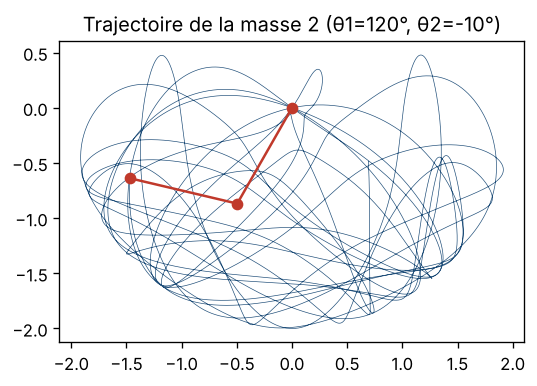
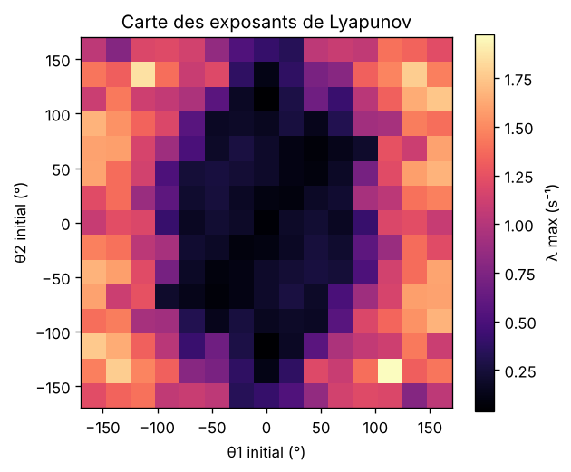
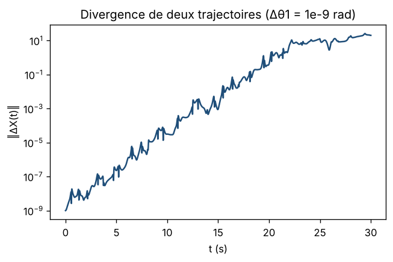
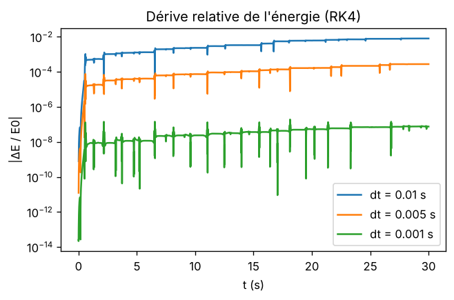

# 🌀 Pendule double : mesurer le chaos

> Projet de modélisation de **Licence 3** (Université de Tours), repris et approfondi : simulation du pendule double et mesure quantitative du chaos (exposants de Lyapunov).

  

## 🎯 Objectif

Le pendule double est le système le plus simple où apparaît le **chaos déterministe** : les équations sont connues, et pourtant une différence d'un milliardième de radian sur l'angle de départ suffit à rendre la trajectoire imprévisible.

Le projet :
1. dérive les équations du mouvement (formalisme de Lagrange) ;
2. les intègre avec un schéma **Runge-Kutta d'ordre 4** écrit à la main ;
3. valide le code par la **conservation de l'énergie** et par la **période des petites oscillations** (solution analytique) ;
4. **mesure** le chaos avec l'exposant de Lyapunov maximal (méthode de Benettin) et cartographie les régions chaotiques.

## 📊 Résultats

| Conditions initiales (θ1, θ2) | Exposant de Lyapunov λ (s⁻¹) | Régime |
|---|---|---|
| (10°, 10°) | 0,031 | régulier (λ ≈ 0) |
| (60°, 60°) | 0,057 | régulier |
| (120°, −10°) | **0,747** | **chaotique** |

| Pas de temps dt | Dérive max. de l'énergie sur 30 s |
|---|---|
| 10⁻² s | 8,1 × 10⁻³ |
| 5 × 10⁻³ s | 3,0 × 10⁻⁴ |
| 10⁻³ s | **1,9 × 10⁻⁷** |

> 💡 Ordre de convergence mesuré : **4,6** (théorie RK4 : 4). Sur la grille des conditions initiales, **63 %** des points sont chaotiques (λ > 0,5 s⁻¹).
> Avec λ ≈ 0,75 s⁻¹, une erreur initiale de 10⁻⁹ est multipliée par e ≈ 2,7 toutes les 1,3 s : au bout de 30 s, la trajectoire n'a plus rien à voir.

| Trajectoire | Carte du chaos |
|---|---|
|  |  |
|  |  |

## 🏗 Architecture du projet

```
01-pendule-double-chaos/
├── src/
│   ├── simulation.py   # équations du mouvement, RK4, énergie, Lyapunov
│   └── analyse.py      # simulations + figures + resultats.json
├── tests/
│   └── test_simulation.py
├── figures/            # 4 figures générées
├── resultats.json      # métriques générées automatiquement
└── README.md
```

## 🔧 Démarche, étape par étape

- **Étape 1 — Modèle physique.** État `(θ1, ω1, θ2, ω2)`, équations de Lagrange pour deux masses ponctuelles.
- **Étape 2 — Intégration.** RK4 à pas fixe, implémenté sans bibliothèque de résolution (pour maîtriser l'erreur).
- **Étape 3 — Validation.** L'énergie doit rester constante ; dans la limite des petits angles, la période du mode en phase doit valoir `2π / √((2−√2) g/l)`. Les deux sont vérifiés par des tests automatiques.
- **Étape 4 — Mesure du chaos.** Deux trajectoires voisines (écart 10⁻⁸), renormalisées régulièrement : λ = ⟨ln(d/d₀)⟩ / t.

## 🚀 Installation et lancement

```bash
git clone https://github.com/IsmailaDEH/Ismaila.git
cd Ismaila
pip install -r requirements.txt
cd projets/01-pendule-double-chaos
python src/analyse.py      # ~45 s, régénère figures/ et resultats.json
python -m pytest tests     # 4 tests
```

## 🧭 Pistes d'amélioration

- [ ] Section de Poincaré pour visualiser la transition régulier → chaos
- [ ] Animation (GIF) du pendule
- [ ] Intégrateur symplectique et comparaison avec RK4

## 👤 Auteur

**Ismaila AMADOU DEH**, M2 Physique Fondamentale (Théories Quantiques), Université de Tours · [GitHub](https://github.com/IsmailaDEH) · [LinkedIn](https://www.linkedin.com/in/ismaila-amadou-deh)

## 🔗 Projets connexes

- [Orbites et intégrateurs numériques](../05-orbites-kepler-integrateurs) : même question de précision numérique, en mécanique céleste
- [Découverte d'équations par apprentissage (SINDy)](../04-decouverte-equations-sindy) : retrouver les équations d'un autre système chaotique
