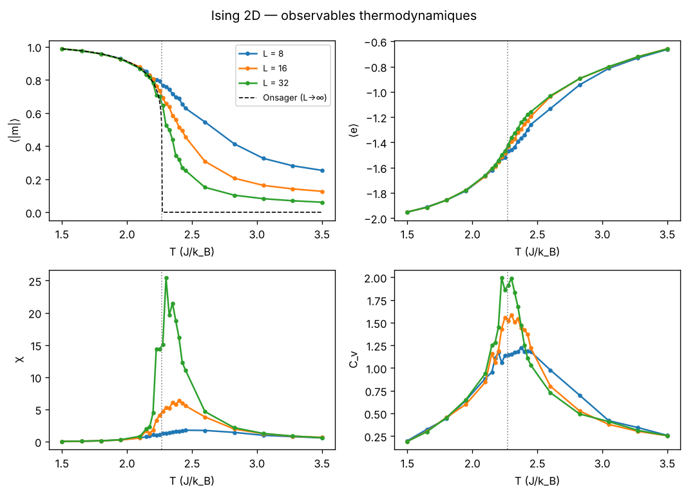
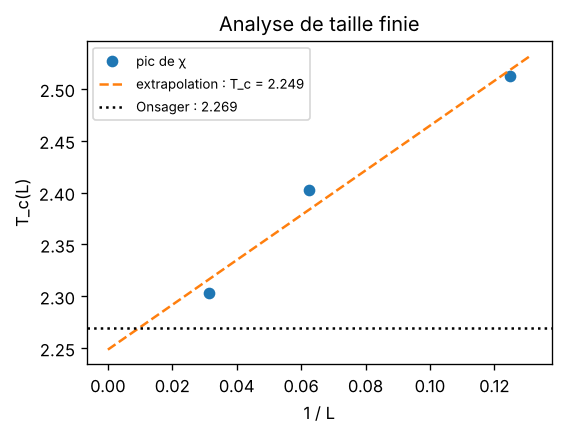
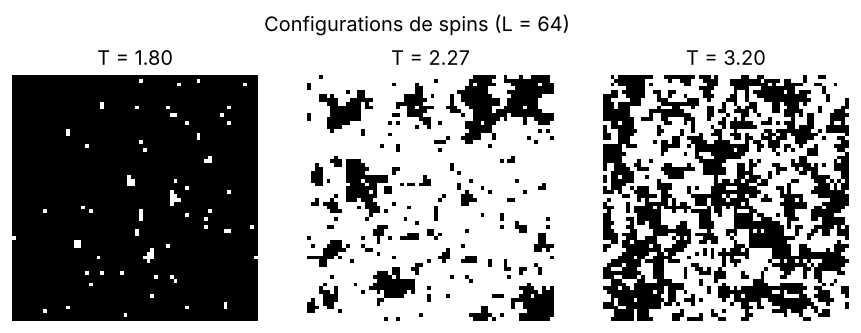

# 🧲 Modèle d'Ising 2D : transition de phase par Monte-Carlo

> Physique statistique numérique : retrouver la température critique d'un aimant à partir d'une simulation Monte-Carlo.

  

## 🎯 Objectif

Le modèle d'Ising décrit un aimant comme une grille de spins ±1 qui préfèrent s'aligner avec leurs voisins. En dessous d'une **température critique T_c**, l'aimant s'ordonne spontanément (ferromagnétisme) ; au-dessus, l'agitation thermique gagne.

Onsager a calculé la valeur exacte en 1944 : **T_c = 2 / ln(1+√2) ≈ 2,269**. Le but du projet est de **retrouver ce nombre par simulation**, en partant uniquement de la règle microscopique.

## 📊 Résultats

| Taille du réseau L × L | T_c estimée (pic de susceptibilité) |
|---|---|
| 8 × 8 | 2,512 |
| 16 × 16 | 2,402 |
| 32 × 32 | 2,304 |
| **Extrapolation L → ∞** | **2,249** |
| Valeur exacte (Onsager) | 2,269 |

> 💡 Erreur relative de **0,9 %** sur la température critique, obtenue par une **analyse de taille finie** : T_c(L) = T_c(∞) + a/L.



| Analyse de taille finie | Configurations de spins |
|---|---|
|  |  |

## 🏗 Architecture du projet

```
02-modele-ising-monte-carlo/
├── src/
│   ├── simulation.py   # Hamiltonien, Metropolis en damier, observables, solution d'Onsager
│   └── analyse.py      # balayage en température, taille finie, figures
├── tests/
│   └── test_ising.py
├── figures/
├── resultats.json
└── README.md
```

## 🔧 Démarche, étape par étape

- **Étape 1 — Algorithme de Metropolis.** Un spin est retourné avec la probabilité min(1, e^(−ΔE/T)). Mise à jour **en damier** (cases noires puis blanches) : on peut vectoriser avec NumPy tout en respectant le bilan détaillé, ce qui rend le code environ 100 fois plus rapide qu'une double boucle Python.
- **Étape 2 — Observables.** Aimantation ⟨|m|⟩, énergie ⟨e⟩, susceptibilité χ = N(⟨m²⟩−⟨|m|⟩²)/T, chaleur spécifique C_v = N(⟨e²⟩−⟨e⟩²)/T².
- **Étape 3 — Balayage en température** de 1,5 à 3,5 (resserré autour de T_c), 800 balayages de thermalisation puis 4 000 de mesure par point, pour 3 tailles.
- **Étape 4 — Taille finie.** Le pic de χ se déplace avec L ; on ajuste T_c(L) en fonction de 1/L (exposant ν = 1 en 2D) et on extrapole.

## 🚀 Installation et lancement

```bash
pip install -r requirements.txt          # depuis la racine du dépôt
cd projets/02-modele-ising-monte-carlo
python src/analyse.py                    # ~35 s
python -m pytest tests
```

## 🧭 Pistes d'amélioration

- [ ] Algorithme de Wolff (clusters) pour supprimer le ralentissement critique
- [ ] Cumulant de Binder pour une estimation de T_c sans extrapolation
- [ ] Exposants critiques β, γ par collapse des courbes

## 👤 Auteur

**Ismaila DEH**, étudiant en physique · [GitHub](https://github.com/IsmailaDEH)

## 🔗 Projets connexes

- [Pendule double et chaos](../01-pendule-double-chaos)
- [Équation de la chaleur](../03-equation-chaleur-differences-finies) : la thermodynamique, côté équations aux dérivées partielles
