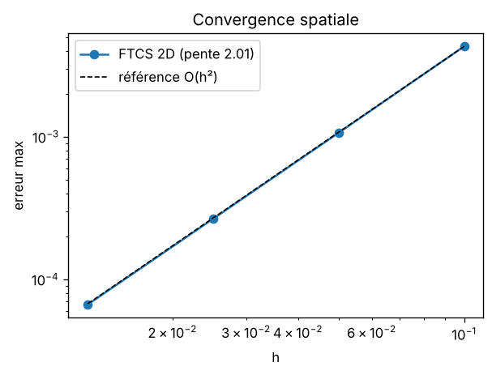
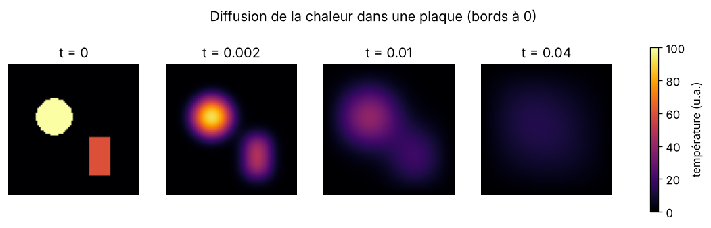

# 🔥 Équation de la chaleur : différences finies et stabilité

> Résolution numérique d'une EDP : validation contre la solution exacte, ordre de convergence et critère de stabilité.

  

## 🎯 Objectif

L'équation de la chaleur ∂u/∂t = α Δu décrit la diffusion de la température (et de nombreux autres phénomènes : concentration chimique, prix d'options...). Le projet implémente deux schémas numériques et **prouve par l'expérience** leurs propriétés théoriques :

- **FTCS 2D** (explicite) : simple, mais stable seulement si r = α·dt/h² ≤ 1/4 ;
- **Crank–Nicolson 1D** (implicite) : stable quel que soit le pas de temps, précis à l'ordre 2 en temps.

## 📊 Résultats

| Maillage n × n | Erreur max. vs solution exacte |
|---|---|
| 10 × 10 | 4,29 × 10⁻³ |
| 20 × 20 | 1,06 × 10⁻³ |
| 40 × 40 | 2,65 × 10⁻⁴ |
| 80 × 80 | 6,62 × 10⁻⁵ |

| Propriété | Théorie | Mesuré |
|---|---|---|
| Ordre spatial FTCS | 2 | **2,01** |
| Ordre temporel Crank–Nicolson | 2 | **2,01** |
| Seuil de stabilité FTCS 2D | r ≤ 0,25 | stable à 0,25, **instable dès 0,26** |

> 💡 Diviser le pas d'espace par 2 divise l'erreur par 4, comme prévu par la théorie. Le seuil de stabilité de von Neumann est retrouvé au centième près.

| Convergence | Application : plaque avec deux sources chaudes |
|---|---|
|  |  |

## 🏗 Architecture du projet

```
03-equation-chaleur-differences-finies/
├── src/
│   ├── simulation.py   # FTCS 2D, Crank–Nicolson 1D (solveur tridiagonal), solution exacte
│   └── analyse.py      # convergence, stabilité, cas d'application
├── tests/
│   └── test_chaleur.py
├── figures/
├── resultats.json
└── README.md
```

## 🔧 Démarche, étape par étape

- **Étape 1 — Discrétisation.** Laplacien à 5 points, conditions de Dirichlet nulles sur les bords.
- **Étape 2 — Validation.** Le mode sin(πx)·sin(πy)·e^(−2π²αt) est une solution exacte : on mesure l'erreur sur 4 maillages et on en déduit l'ordre.
- **Étape 3 — Stabilité.** On ajoute un bruit de 10⁻⁶ et on augmente r : au-delà de 1/4, le bruit est amplifié de façon exponentielle.
- **Étape 4 — Schéma implicite.** Crank–Nicolson avec `scipy.linalg.solve_banded` : un système tridiagonal par pas de temps, coût O(n).
- **Étape 5 — Application.** Refroidissement d'une plaque contenant deux zones chaudes.

## 🚀 Installation et lancement

```bash
pip install -r requirements.txt          # depuis la racine du dépôt
cd projets/03-equation-chaleur-differences-finies
python src/analyse.py                    # ~1 s
python -m pytest tests
```

## 🧭 Pistes d'amélioration

- [ ] Méthode ADI (Crank–Nicolson en 2D)
- [ ] Conditions aux limites de Neumann (bord isolé)
- [ ] Comparaison avec un PINN (réseau de neurones informé par la physique)

## 👤 Auteur

**Ismaila AMADOU DEH**, M2 Physique Fondamentale (Théories Quantiques), Université de Tours · [GitHub](https://github.com/IsmailaDEH) · [LinkedIn](https://www.linkedin.com/in/ismaila-amadou-deh)

## 🔗 Projets connexes

- [Modèle d'Ising](../02-modele-ising-monte-carlo)
- [Orbites et intégrateurs](../05-orbites-kepler-integrateurs) : ordres de convergence pour les EDO
