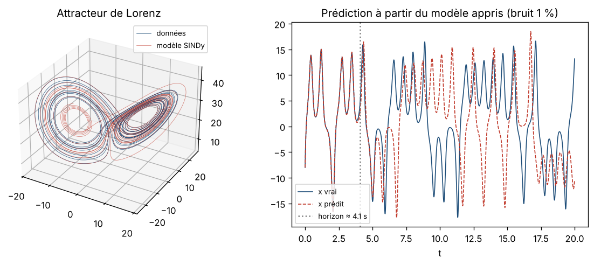
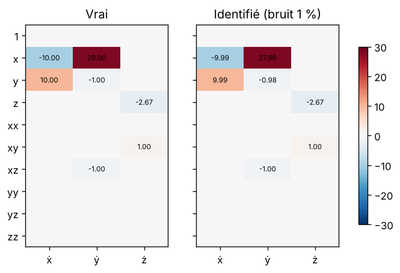

# 🤖 Découverte automatique d'équations physiques (SINDy)

> Physique + apprentissage automatique : retrouver les équations de Lorenz à partir de données bruitées, sans les connaître à l'avance.

  

## 🎯 Objectif

Un réseau de neurones peut prédire une trajectoire, mais il ne dit pas **quelle loi physique** la produit. La méthode **SINDy** (*Sparse Identification of Nonlinear Dynamics*, Brunton, Proctor et Kutz, PNAS 2016) fait autre chose : elle part des données et **renvoie une équation lisible**.

Principe : on écrit dX/dt ≈ Θ(X)·Ξ, où Θ contient des fonctions candidates (1, x, y, z, x², xy, ...), puis on cherche Ξ **creux** (peu de termes non nuls), parce que les lois physiques sont en général simples.

Test sur le système chaotique de **Lorenz** (σ = 10, ρ = 28, β = 8/3), avec un bruit de mesure croissant.

## 📊 Résultats

| Bruit de mesure | σ trouvé | ρ trouvé | β trouvé | Erreur max. | Bons termes identifiés |
|---|---|---|---|---|---|
| 0 % | 9,999 | 27,992 | 2,666 | 0,03 % | ✅ |
| 0,1 % | 10,000 | 27,995 | 2,667 | 0,02 % | ✅ |
| 1 % | 9,994 | 27,963 | 2,666 | **0,13 %** | ✅ |
| 5 % | 9,830 | 25,285 | 2,661 | 9,7 % | ❌ (limite de la méthode) |

**Équations découvertes avec 1 % de bruit** (sur 30 termes candidats, seuls 7 sont retenus) :

```
dx/dt = -9.99·x + 9.99·y
dy/dt = 27.96·x - 0.98·y - 1.00·xz
dz/dt = -2.67·z + 1.00·xy
```

> 💡 Le modèle appris, simulé seul, reproduit la trajectoire réelle pendant **≈ 4 s** (environ 4 tours de l'attracteur) avant que le chaos ne fasse diverger les deux courbes. C'est attendu : même les vraies équations divergent à cause de la sensibilité aux conditions initiales (voir le [pendule double](../01-pendule-double-chaos)).




## 🏗 Architecture du projet

```
04-decouverte-equations-sindy/
├── src/
│   ├── sindy.py        # bibliothèque de fonctions, dérivation, régression STLSQ (from scratch)
│   └── analyse.py      # robustesse au bruit, validation, figures
├── tests/
│   └── test_sindy.py
├── figures/
├── resultats.json
└── README.md
```

## 🔧 Pipeline, étape par étape

- **Étape 1 — Données.** Simulation de Lorenz (20 s, dt = 0,002), puis ajout d'un bruit gaussien proportionnel à l'écart-type de chaque variable.
- **Étape 2 — Dérivées.** Le point délicat : dériver un signal bruité amplifie le bruit. Solution retenue : filtre de **Savitzky–Golay** (ajustement polynomial local).
- **Étape 3 — Régression creuse (STLSQ).** Moindres carrés, puis on met à zéro les coefficients sous un seuil et on recommence. Implémenté en 15 lignes de NumPy.
- **Étape 4 — Robustesse.** Tableau ci-dessus : la méthode tient jusqu'à ~1 % de bruit puis se dégrade.
- **Étape 5 — Validation.** On intègre le modèle appris et on le compare aux données.

## 🚀 Installation et lancement

```bash
pip install -r requirements.txt          # depuis la racine du dépôt
cd projets/04-decouverte-equations-sindy
python src/analyse.py                    # ~4 s
python -m pytest tests
```

## 🧭 Pistes d'amélioration

- [ ] Données réelles : oscillations d'un pendule filmé (suivi vidéo)
- [ ] Dérivation par variation totale régularisée pour mieux supporter 5 % de bruit
- [ ] Comparaison avec un réseau de neurones (précision vs interprétabilité)

## 👤 Auteur

**Ismaila DEH**, étudiant en physique · [GitHub](https://github.com/IsmailaDEH)

## 🔗 Projets connexes

- [Pendule double et chaos](../01-pendule-double-chaos)
- [Équation de la chaleur](../03-equation-chaleur-differences-finies)
