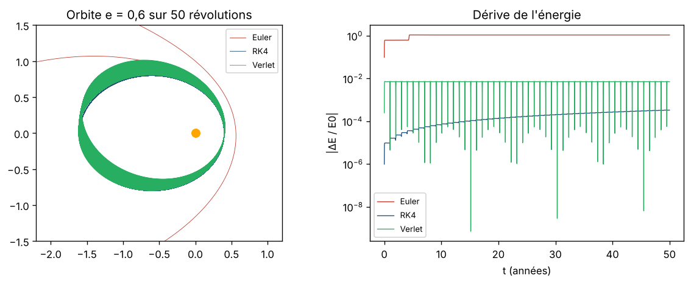
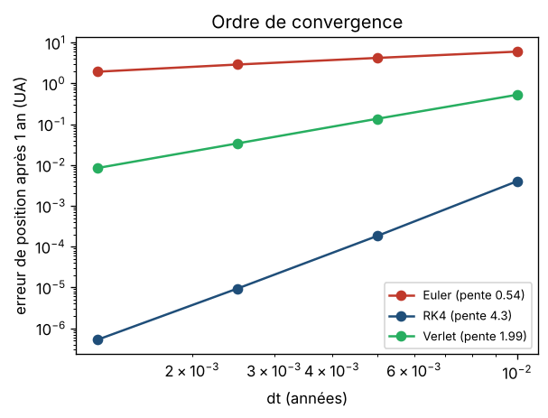
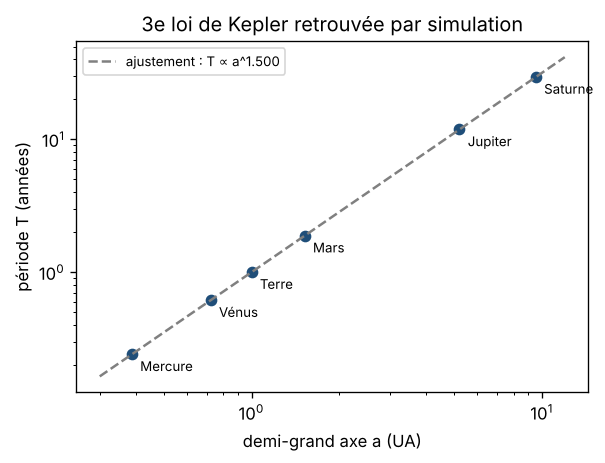

# 🪐 Orbites planétaires : pourquoi le choix de l'intégrateur compte

> Mécanique céleste numérique : Euler, RK4 et Verlet comparés sur 50 révolutions, et 3ᵉ loi de Kepler retrouvée par simulation.

  

## 🎯 Objectif

Simuler une planète autour du Soleil paraît simple, mais sur des milliers d'orbites, la méthode numérique décide si la planète reste en orbite, s'échappe ou tombe sur le Soleil.

Le projet compare trois intégrateurs sur une orbite très elliptique (e = 0,6) et vérifie les **lois de Kepler** avec les vraies données des planètes. Unités astronomiques : UA, années, GM☉ = 4π².

## 📊 Résultats

**Après 50 révolutions** (dt = 1/200 an) :

| Intégrateur | Dérive de l'énergie | Dérive du moment cinétique | Évaluations de force par pas | Ordre mesuré |
|---|---|---|---|---|
| Euler | 1,1 (110 %) : la planète s'échappe | 4,1 × 10⁻¹ | 1 | 0,54* |
| RK4 | 3,3 × 10⁻⁴, **croît sans cesse** | 3,7 × 10⁻⁵ | 4 | 4,30 |
| **Verlet** | ≤ 7 × 10⁻³, **bornée, ne croît pas** | **8,1 × 10⁻¹⁵** | 1 | 1,99 |

<sub>* Euler est d'ordre 1 en théorie ; à ces pas de temps, l'orbite e = 0,6 est trop dégradée pour être dans le régime asymptotique.</sub>

> 💡 **À retenir :** RK4 est plus précis sur une orbite, mais son erreur d'énergie s'accumule. Verlet, quatre fois moins coûteux, est **symplectique** : son erreur oscille sans dériver et il conserve le moment cinétique à la précision machine. C'est pour cette raison qu'on utilise ce type de schéma en dynamique moléculaire et pour le système solaire à long terme.

**3ᵉ loi de Kepler (T² ∝ a³) retrouvée sur 6 planètes :**

| Planète | a (UA) | T simulée (années) | T réelle (années) |
|---|---|---|---|
| Mercure | 0,387 | 0,241 | 0,241 |
| Vénus | 0,723 | 0,615 | 0,615 |
| Terre | 1,000 | 1,000 | 1,000 |
| Mars | 1,524 | 1,881 | 1,881 |
| Jupiter | 5,203 | 11,868 | 11,86 |
| Saturne | 9,537 | 29,452 | 29,46 |

Pente de log T en fonction de log a : **1,5000** (théorie : 3/2).



| Ordre de convergence | Loi de Kepler |
|---|---|
|  |  |

## 🏗 Architecture du projet

```
05-orbites-kepler-integrateurs/
├── src/
│   ├── simulation.py   # gravitation, Euler / RK4 / Verlet, mesure de période
│   └── analyse.py      # comparaison, convergence, Kepler, figures
├── tests/
│   └── test_orbites.py
├── figures/
├── resultats.json
└── README.md
```

## 🔧 Démarche, étape par étape

- **Étape 1 — Modèle.** Force en 1/r², conditions initiales au périhélie : r_p = a(1−e), v_p = √(GM(1+e)/r_p).
- **Étape 2 — Intégrateurs.** Trois schémas écrits à la main, même interface.
- **Étape 3 — Invariants.** Énergie et moment cinétique mesurés à chaque pas.
- **Étape 4 — Convergence.** Erreur de position après un tour complet pour 4 pas de temps.
- **Étape 5 — Kepler.** Période mesurée par interpolation des passages au périhélie, puis ajustement log-log.

## 🚀 Installation et lancement

```bash
pip install -r requirements.txt          # depuis la racine du dépôt
cd projets/05-orbites-kepler-integrateurs
python src/analyse.py                    # ~2 s
python -m pytest tests
```

## 🧭 Pistes d'amélioration

- [ ] Problème à N corps (perturbations de Jupiter sur les astéroïdes)
- [ ] Précession relativiste de Mercure (correction en 1/r³)
- [ ] Intégrateurs symplectiques d'ordre 4 (Forest–Ruth, Yoshida)

## 👤 Auteur

**Ismaila DEH**, étudiant en physique · [GitHub](https://github.com/IsmailaDEH)

## 🔗 Projets connexes

- [Pendule double et chaos](../01-pendule-double-chaos)
- [Équation de la chaleur](../03-equation-chaleur-differences-finies)
