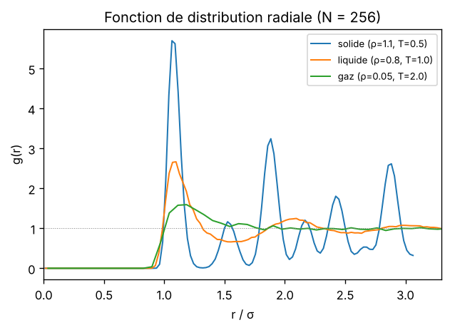
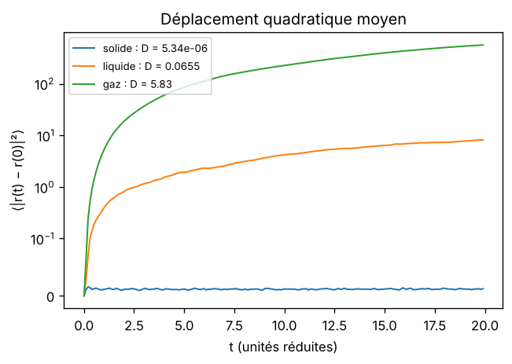
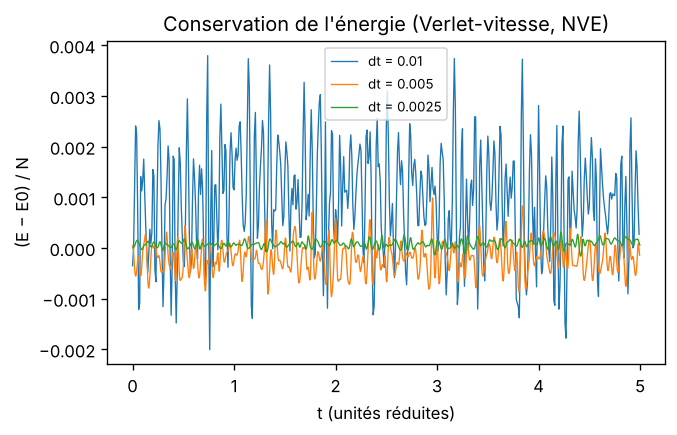
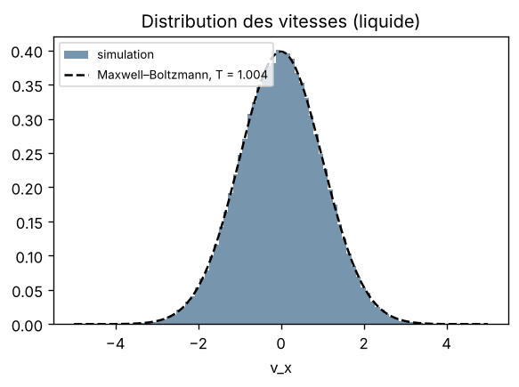

# ⚛️ Dynamique moléculaire de l'argon (Lennard-Jones)

> Simulation atomistique écrite de zéro : 256 atomes, intégrateur de Verlet, conditions périodiques. On retrouve les phases solide, liquide et gaz ainsi que les grandeurs mesurables (structure, pression, diffusion).

  

## 🎯 Objectif

La dynamique moléculaire relie le **microscopique** (forces entre atomes) au **macroscopique** (pression, coefficient de diffusion, structure). C'est l'outil de base de la simulation des matériaux, utilisé par des codes comme LAMMPS ou GROMACS. Ici, tout est codé à la main pour en comprendre chaque brique :

- potentiel de **Lennard-Jones** V(r) = 4ε[(σ/r)¹² − (σ/r)⁶], tronqué et décalé à r_c = 2,5σ ;
- intégrateur **Verlet-vitesse** (symplectique, réversible en temps) ;
- **conditions aux limites périodiques** et convention de l'image minimale ;
- **thermostat** par remise à l'échelle des vitesses (équilibrage), puis mesures en NVE ;
- observables : g(r), pression par le **théorème du viriel**, coefficient de diffusion par la **relation d'Einstein**.

Unités réduites (σ = ε = m = k_B = 1). Pour l'argon : σ = 3,405 Å, ε/k_B = 119,8 K, τ = 2,156 ps.

## 📊 Résultats

| Phase | ρ* | T* cible / mesurée | Pression P* | E_pot / atome | Diffusion D* | Pic de g(r) |
|---|---|---|---|---|---|---|
| Solide (CFC) | 1,10 | 0,50 / 0,513 | 6,55 | −6,71 | 5 × 10⁻⁶ (≈ 0) | 5,7 à r = 1,06σ |
| Liquide | 0,80 | 1,00 / 1,004 | 1,66 | −4,70 | **0,066** | 2,7 à r = 1,10σ |
| Gaz | 0,05 | 2,00 / 1,986 | 0,096 | −0,28 | 5,8 | 1,6 à r = 1,19σ |

| Validation | Attendu | Mesuré |
|---|---|---|
| Fluctuation d'énergie NVE en fonction de dt | ∝ dt² (Verlet) | ordre **2,04** |
| Distribution des vitesses | Maxwell–Boltzmann, kurtosis = 3 | kurtosis **2,995** ; écart max. 0,008 |
| Gaz dilué : P ≈ ρT (gaz parfait) | 0,100 | 0,096 (Z = 0,96 < 1 : attraction) |
| 3ᵉ loi de Newton (Σ F = 0) et F = −∇U | exact | vérifié par les tests |

> 💡 Pour le liquide, D* = 0,066 correspond à **≈ 3,5 × 10⁻⁵ cm²/s** en unités de l'argon : le bon ordre de grandeur pour un liquide simple (~10⁻⁵ cm²/s). Dans le solide, le déplacement quadratique sature (les atomes vibrent autour de leur site) ; dans le gaz, il est d'abord balistique (∝ t²) puis diffusif (∝ t).

| Structure g(r) : les trois phases | Diffusion |
|---|---|
|  |  |
|  |  |

## 🏗 Architecture du projet

```
06-dynamique-moleculaire-lennard-jones/
├── src/
│   ├── md.py           # réseau CFC, forces LJ vectorisées, Verlet, thermostat, g(r)
│   └── analyse.py      # validation NVE, 3 phases, diffusion, Maxwell–Boltzmann
├── tests/
│   └── test_md.py      # Newton, F = −∇U (différences finies), conservation
├── figures/
├── resultats.json
└── README.md
```

## 🔧 Démarche, étape par étape

- **Étape 1 — Initialisation.** 256 atomes sur un réseau CFC, vitesses gaussiennes avec quantité de mouvement totale nulle.
- **Étape 2 — Forces.** Calcul vectorisé de toutes les paires avec NumPy, image minimale, troncature à 2,5σ. Le test `F = −∇U` compare la force à une dérivée numérique de l'énergie.
- **Étape 3 — Équilibrage NVT.** 3 000 pas avec remise à l'échelle des vitesses toutes les 10 itérations.
- **Étape 4 — Production NVE.** 4 000 pas sans thermostat ; mesures de T, P (viriel), U, du déplacement quadratique moyen et de g(r).
- **Étape 5 — Analyse.** D = pente(MSD)/6 sur le régime diffusif ; conversion vers les unités de l'argon.

## 🚀 Installation et lancement

```bash
pip install -r requirements.txt          # depuis la racine du dépôt
cd projets/06-dynamique-moleculaire-lennard-jones
python src/analyse.py                    # ~3 min
python -m pytest tests
```

## 🧭 Pistes d'amélioration

- [ ] Listes de voisins (Verlet lists / cellules) : passer de O(N²) à O(N)
- [ ] Thermostat de Nosé–Hoover (vrai ensemble canonique)
- [ ] Courbe de fusion et coexistence liquide–vapeur
- [ ] Même étude avec LAMMPS pour comparer
- [ ] Remplacer Lennard-Jones par un potentiel appris (voir [projet 07](../07-potentiel-interatomique-incertitude))

## 👤 Auteur

**Ismaila AMADOU DEH**, M2 Physique Fondamentale (Théories Quantiques), Université de Tours · [GitHub](https://github.com/IsmailaDEH) · [LinkedIn](https://www.linkedin.com/in/ismaila-amadou-deh)

## 🔗 Projets connexes

- [Potentiel interatomique appris avec incertitude](../07-potentiel-interatomique-incertitude)
- [Modèle d'Ising par Monte-Carlo](../02-modele-ising-monte-carlo) : l'autre grande méthode de la physique statistique numérique
- [Orbites et intégrateurs](../05-orbites-kepler-integrateurs) : pourquoi Verlet est le bon choix
