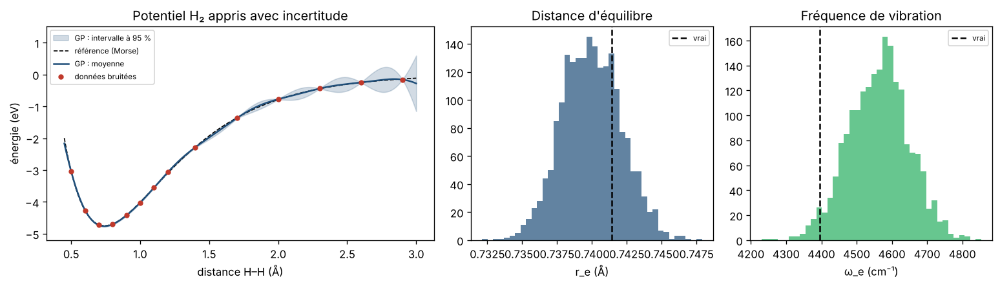
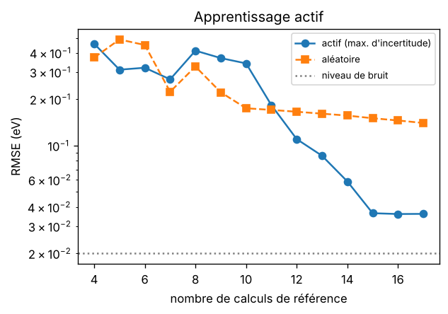
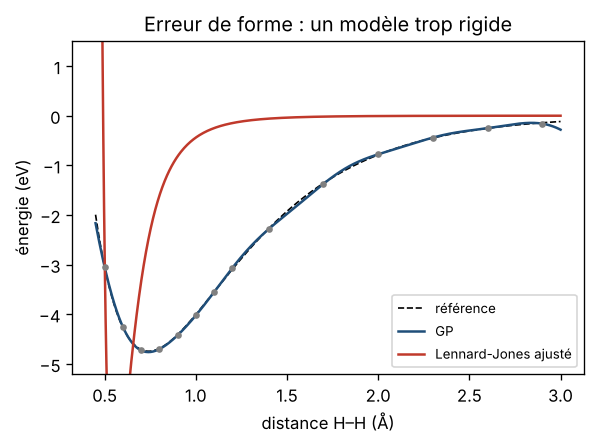

# 📉 Potentiel interatomique appris et quantification d'incertitude

> Apprendre un potentiel interatomique à partir de quelques calculs « de référence » bruités, avec un processus gaussien, puis **propager l'incertitude** jusqu'aux grandeurs physiques (distance d'équilibre, fréquence de vibration).

  

## 🎯 Objectif

En simulation des matériaux, les potentiels interatomiques sont de plus en plus **appris** sur des calculs ab initio (DFT) coûteux : GAP, MLIP, réseaux de neurones. Deux questions se posent alors :

1. **À quel point peut-on faire confiance au potentiel appris ?** C'est la quantification d'incertitude (UQ).
2. **Où faire le prochain calcul coûteux ?** C'est l'apprentissage actif.

Cas d'étude contrôlé : la molécule **H₂**. Sa courbe d'énergie « vraie » est un potentiel de Morse aux paramètres spectroscopiques (D_e = 4,745 eV, a = 1,943 Å⁻¹, r_e = 0,7414 Å), donc tout se vérifie. On n'en donne au modèle que 14 points bruités (σ = 0,02 eV), comme des calculs DFT imparfaits.

## 📊 Résultats

| Grandeur | Vraie valeur | Processus gaussien (± 1σ) | Lennard-Jones ajusté (± 1σ) |
|---|---|---|---|
| Distance d'équilibre r_e | 0,7414 Å | **0,7400 ± 0,0021 Å** ✅ | 0,543 ± 0,009 Å ❌ |
| Fréquence ω_e | 4 396 cm⁻¹ | **4 562 ± 85 cm⁻¹** (à 2σ) | ≈ 38 000 cm⁻¹ ❌ |

| Diagnostic | Valeur |
|---|---|
| Hyperparamètres optimisés (vraisemblance marginale) | amplitude 2,85 eV, longueur 0,34 Å |
| Bruit estimé par le GP / bruit réel | 0,011 / 0,020 eV |
| Couverture réelle de l'intervalle à 95 % | 85 % |
| RMSE après 12 calculs : apprentissage **actif** / **aléatoire** | **0,11** / 0,17 eV |

> 💡 **Trois leçons :**
> 1. Le GP donne une valeur **et une barre d'erreur**, propagée à r_e et ω_e par 2 000 tirages de la loi a posteriori.
> 2. Avec si peu de données, le GP **sous-estime le bruit** (0,011 contre 0,020 eV) : son intervalle à 95 % ne couvre que 85 % de la vraie courbe. C'est l'enjeu de la **calibration** de l'incertitude, que l'on vérifie seulement quand on a la vérité terrain.
> 3. Le modèle de **Lennard-Jones**, trop rigide pour une liaison covalente, se trompe de 27 % sur r_e tout en affichant une barre d'erreur minuscule. **L'incertitude statistique ne voit pas l'erreur de forme du modèle.**



| Apprentissage actif | Erreur de forme du modèle |
|---|---|
|  |  |

## 🏗 Architecture du projet

```
07-potentiel-interatomique-incertitude/
├── src/
│   ├── gp.py           # Morse H2, processus gaussien (Cholesky), propriétés r_e et k
│   └── analyse.py      # propagation d'incertitude, apprentissage actif, comparaison LJ
├── tests/
│   └── test_gp.py
├── figures/
├── resultats.json
└── README.md
```

## 🔧 Démarche, étape par étape

- **Étape 1 — Données de référence.** 14 distances H–H, énergies de Morse + bruit gaussien de 0,02 eV.
- **Étape 2 — Processus gaussien codé de zéro.** Noyau gaussien (RBF) ; hyperparamètres (amplitude, longueur de corrélation, bruit) obtenus en maximisant la vraisemblance marginale ; inversion par décomposition de Cholesky.
- **Étape 3 — Propagation de l'incertitude.** 2 000 courbes tirées de la loi a posteriori ; pour chacune, r_e et k = E''(r_e) (polynôme de degré 4 local, qui absorbe l'anharmonicité) ; puis ω_e = √(k/μ)/(2πc).
- **Étape 4 — Apprentissage actif.** On part de 4 points et on ajoute à chaque fois le point où l'incertitude est maximale, comparé à un ajout aléatoire.
- **Étape 5 — Erreur de modèle.** Ajustement d'un Lennard-Jones aux mêmes données, avec propagation de la covariance des paramètres.

## 🚀 Installation et lancement

```bash
pip install -r requirements.txt          # depuis la racine du dépôt
cd projets/07-potentiel-interatomique-incertitude
python src/analyse.py                    # ~10 s
python -m pytest tests
```

## 🧭 Pistes d'amélioration

- [ ] Vraies données DFT (par exemple avec PySCF) au lieu de Morse
- [ ] Apprentissage sur les forces en plus des énergies (GP avec dérivées)
- [ ] Passage à plusieurs atomes : descripteurs SOAP, approche GAP
- [ ] Recalibration de l'incertitude (validation croisée, conformal prediction)
- [ ] Utiliser le potentiel appris dans la [dynamique moléculaire](../06-dynamique-moleculaire-lennard-jones)

## 👤 Auteur

**Ismaila AMADOU DEH**, M2 Physique Fondamentale (Théories Quantiques), Université de Tours · [GitHub](https://github.com/IsmailaDEH) · [LinkedIn](https://www.linkedin.com/in/ismaila-amadou-deh)

## 🔗 Projets connexes

- [Dynamique moléculaire Lennard-Jones](../06-dynamique-moleculaire-lennard-jones)
- [Découverte d'équations (SINDy)](../04-decouverte-equations-sindy) : l'autre approche « physique + apprentissage » de ce dépôt
