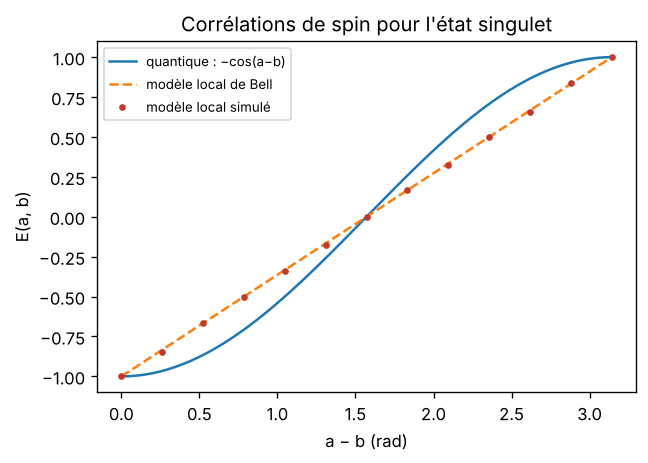
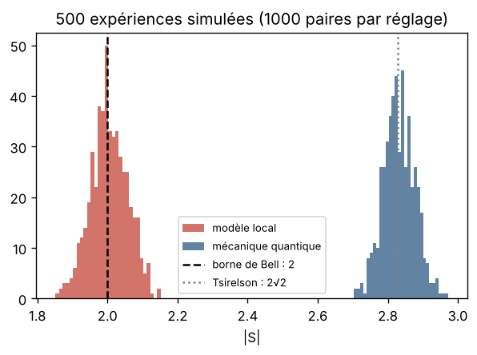
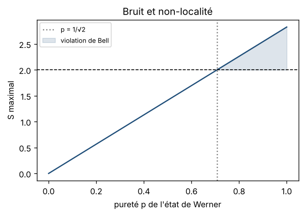

# 🔗 Inégalités de Bell–CHSH : simulation d'une expérience de non-localité

> Mécanique quantique contre variables cachées locales : calcul matriciel des corrélations, expérience de Bell simulée, borne de Tsirelson retrouvée par optimisation et effet de la décohérence.

  

## 🎯 Objectif

Ce projet prolonge mon **stage de recherche de M1** à l'Institut Denis Poisson (Pr. S. Nicolis) sur le modèle de Freund (1981) : variables cachées fermioniques, algèbre de Grassmann et corrélations EPR. Il en reprend la question centrale sous forme numérique : **une théorie locale à variables cachées peut-elle reproduire les corrélations quantiques ?**

Pour deux spins dans l'état singulet, mesurés selon les directions a, a′ (Alice) et b, b′ (Bob) :

S = E(a,b) − E(a,b′) + E(a′,b) + E(a′,b′)

- **toute théorie locale** : |S| ≤ 2 (Bell, Clauser–Horne–Shimony–Holt, 1969) ;
- **mécanique quantique** : |S| ≤ 2√2 ≈ 2,83 (borne de Tsirelson, 1980).

## 📊 Résultats

| Quantité | Théorie | Simulation |
|---|---|---|
| S quantique (angles optimaux) | 2√2 = 2,8284 | **2,848 ± 0,014** (10 000 paires par réglage) |
| Violation de la borne locale | — | **60 écarts-types** |
| S du modèle local de Bell | ≤ 2 | 1,985 ± 0,017 ✅ |
| Max. sur les 16 stratégies locales déterministes | 2 | **2** (énumération exacte) |
| S max. par optimisation numérique des 4 angles | 2√2 | **2,828427** |
| Seuil de violation pour l'état de Werner | p = 1/√2 = 0,707 | **0,71** |

> 💡 Le modèle local reproduit parfaitement les corrélations aux angles 0 et π, mais donne une courbe **en dents de scie** au lieu de −cos(a−b). C'est exactement cet écart, aux angles intermédiaires, que mesure S. Avec du bruit (état de Werner, pureté p), l'intrication existe dès p > 1/3, mais la violation de CHSH n'apparaît qu'au-delà de p = 1/√2.

| Corrélations | 500 expériences simulées |
|---|---|
|  |  |



## 🏗 Architecture du projet

```
08-inegalites-bell-chsh/
├── src/
│   ├── chsh.py         # opérateurs de spin, singulet, règle de Born, modèle local, Werner
│   └── analyse.py      # expérience simulée, optimisation, figures
├── tests/
│   └── test_chsh.py
├── figures/
├── resultats.json
└── README.md
```

## 🔧 Démarche, étape par étape

- **Étape 1 — Formalisme.** Matrices de Pauli, état singulet (|01⟩ − |10⟩)/√2, observable σ·n, produit tensoriel. Les corrélations sont **calculées** par ⟨ψ|A⊗B|ψ⟩, sans utiliser la formule −cos(a−b), qui sert seulement de test.
- **Étape 2 — Expérience simulée.** Résultats ±1 tirés selon la règle de Born (projecteurs sur les états propres), puis estimation de S avec son erreur statistique.
- **Étape 3 — Modèle local.** Variable cachée λ uniforme, A = sign cos(a−λ), B = −sign cos(b−λ) (modèle de Bell, 1964), et énumération des 16 stratégies déterministes.
- **Étape 4 — Tsirelson.** Maximisation de |S| sur les 4 angles, avec 20 départs aléatoires.
- **Étape 5 — Décohérence.** État de Werner ρ = p|ψ⁻⟩⟨ψ⁻| + (1−p)I/4, calcul par Tr(ρ A⊗B).

## 🚀 Installation et lancement

```bash
pip install -r requirements.txt          # depuis la racine du dépôt
cd projets/08-inegalites-bell-chsh
python src/analyse.py                    # ~2 s
python -m pytest tests
```

## 🧭 Pistes d'amélioration

- [ ] Implémentation numérique du modèle de Freund (variables de Grassmann)
- [ ] Inégalité CH et efficacité de détection (échappatoire de détection)
- [ ] Généralisation à des états à 3 qubits (GHZ, inégalité de Mermin)

## 👤 Auteur

**Ismaila AMADOU DEH**, M2 Physique Fondamentale (Théories Quantiques), Université de Tours · [GitHub](https://github.com/IsmailaDEH) · [LinkedIn](https://www.linkedin.com/in/ismaila-amadou-deh)

## 🔗 Projets connexes

- [Modèle d'Ising par Monte-Carlo](../02-modele-ising-monte-carlo)
- [Potentiel interatomique avec incertitude](../07-potentiel-interatomique-incertitude)
