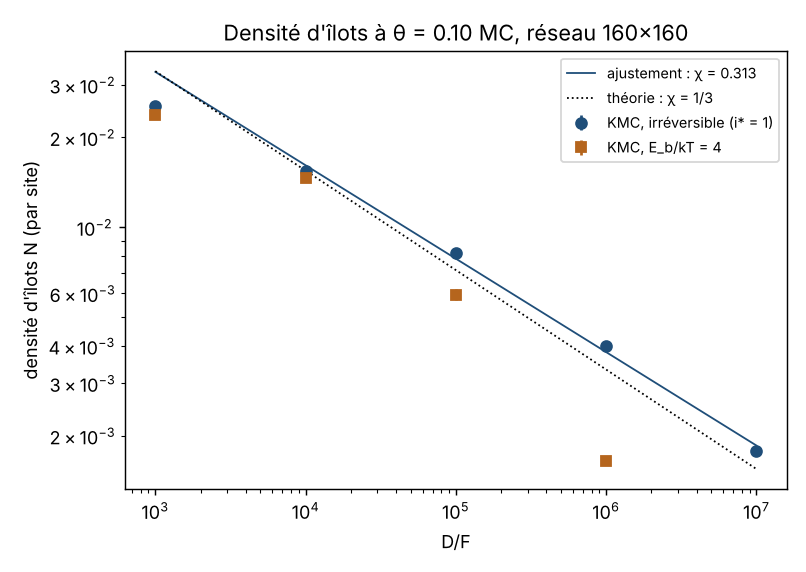
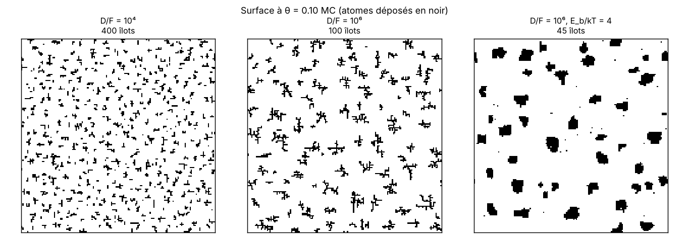
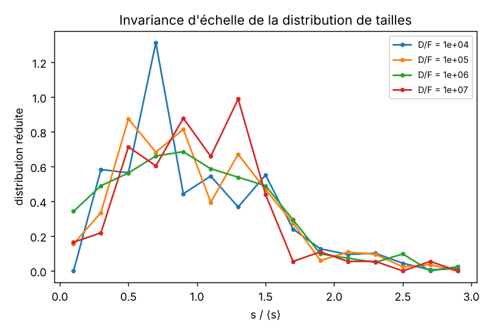

# 🧱 Croissance épitaxiale par Monte-Carlo cinétique

> Projet personnel : simuler les premiers instants de la croissance d'un film mince (dépôt, diffusion, nucléation d'îlots) avec l'algorithme **BKL sans rejet**, et retrouver la loi d'échelle de la théorie de la nucléation.

  -informational)

## 🎯 Objectif

En épitaxie (jets moléculaires, dépôt de matériaux 2D…), deux échelles de temps s'affrontent : le **flux de dépôt F** et la **diffusion D** des atomes sur la surface. Plus les atomes diffusent avant d'être rejoints par d'autres, moins il se forme d'îlots, et plus ils sont gros.

La théorie de la nucléation (Venables) prédit, pour un îlot critique de taille i\* :

$$N \propto \left(\frac{D}{F}\right)^{-\chi}, \qquad \chi = \frac{i^*}{i^*+2}$$

soit **χ = 1/3** quand un dimère est déjà stable (i\* = 1). Le but : **retrouver cet exposant à partir des seules règles microscopiques**.

## 📊 Résultats

| Cas | Exposant χ mesuré | Théorie |
|---|---|---|
| Agrégation irréversible (i\* = 1), D/F de 10⁴ à 10⁷ | **0,313** | 1/3 ≈ 0,333 |
| Liaison finie E_b/kT = 4, D/F de 10⁵ à 10⁶ | **0,56** | entre 1/2 (i\* = 2) et 3/5 (i\* = 3) |

> 💡 Avec une liaison finie, les petits amas se cassent à fort D/F : l'îlot critique grossit et l'exposant augmente, exactement comme le prévoit χ = i\*/(i\*+2). L'écart de 6 % dans le cas irréversible est connu : la loi de puissance n'est qu'asymptotique (corrections logarithmiques, îlots ramifiés à θ = 0,1).



| Morphologies à θ = 0,1 monocouche | Distribution de tailles réduite |
|---|---|
|  |  |

On voit : à faible D/F, beaucoup de petits îlots ; à fort D/F, peu d'îlots **ramifiés** (agrégation limitée par la diffusion, les atomes collent là où ils touchent) ; avec une liaison finie, les atomes de bord se réarrangent et les îlots deviennent **compacts**.

## 🏗 Architecture du projet

```
09-epitaxie-monte-carlo-cinetique/
├── src/
│   ├── kmc.py        # moteur BKL : classes de taux, dépôt, sauts, horloge, amas périodiques
│   └── analyse.py    # balayage en D/F, ajustement de χ, figures
├── tests/test_kmc.py
├── figures/
├── resultats.json
└── README.md
```

## 🔧 Démarche, étape par étape

- **Étape 1 — Modèle « bond counting ».** Un adatome avec n voisins latéraux saute avec le taux h_n = (D/F) · exp(−n E_b/kT). Le dépôt arrive au taux F par site (F = 1 fixe l'unité de temps).
- **Étape 2 — Algorithme BKL (n-fold way).** Au lieu de proposer des sauts et d'en rejeter la plupart (Metropolis), on range les atomes en **5 classes** (n = 0 à 4) de taux identiques. On choisit un événement avec la probabilité taux/taux total, **toujours accepté**, et on avance l'horloge de Δt = −ln(u)/R. Chaque événement ne modifie que les classes de quelques voisins : coût O(1) par événement.
- **Étape 3 — Mesure.** Comptage des îlots (amas connexes de ≥ 2 atomes, conditions périodiques gérées par union-find) à θ = 0,1 MC, réseau 160 × 160, 2 graines par point.
- **Étape 4 — Validation.** Sans dépôt, un adatome seul doit diffuser avec ⟨r²⟩ = h₀ t : testé sur 400 trajectoires.

## 🧪 Ce que vérifient les tests

Couverture exacte · cohérence des classes (chaque atome est dans la classe de son nombre de voisins) · loi de diffusion ⟨r²⟩ = h₀ t · amas qui traversent les bords périodiques · décroissance de N avec D/F · formule χ(i\*).

## 💬 Pour l'expliquer en entretien

- **Pourquoi du Monte-Carlo cinétique et pas de la dynamique moléculaire ?** La DM suit les vibrations atomiques (≈ 10⁻¹³ s) ; un saut de diffusion arrive toutes les ≈ 10⁻⁶ s et le dépôt d'une monocouche prend des secondes. Le KMC saute directement d'un événement rare au suivant.
- **KMC ou Metropolis ?** Metropolis échantillonne un **équilibre** (temps fictif). Le KMC décrit une **cinétique hors équilibre** avec un vrai temps physique, à condition de connaître les taux (barrières d'Arrhenius).
- **D'où viennent les barrières ?** Dans un vrai matériau : calculs DFT (méthode NEB) ou potentiels interatomiques. Ici, un modèle simple à deux paramètres (E_d via D/F, E_b).
- **Limites et suites :** pas de barrière d'Ehrlich-Schwoebel (croissance multicouche), réseau carré idéal, pas de contrainte élastique ni de substrat de van der Waals. Ce sont exactement les ingrédients d'une étude réaliste de l'épitaxie de matériaux 2D.

## 🚀 Installation et lancement

```bash
pip install -r requirements.txt               # depuis la racine du dépôt
cd projets/09-epitaxie-monte-carlo-cinetique
python src/analyse.py                         # ~3 min
python -m pytest tests
```

**Références :** A. B. Bortz, M. H. Kalos, J. L. Lebowitz, *J. Comput. Phys.* 17, 10 (1975) · J. A. Venables, *Philos. Mag.* 27, 697 (1973) · J. W. Evans, P. A. Thiel, M. C. Bartelt, *Surf. Sci. Rep.* 61, 1 (2006).
