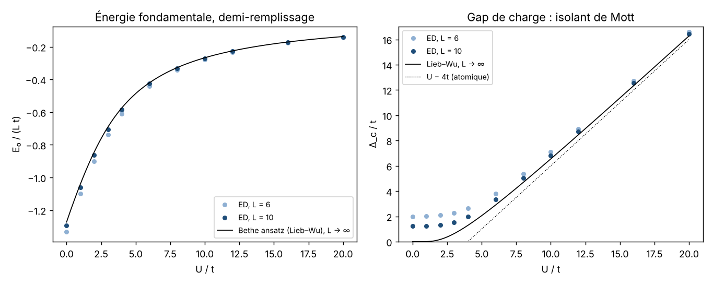
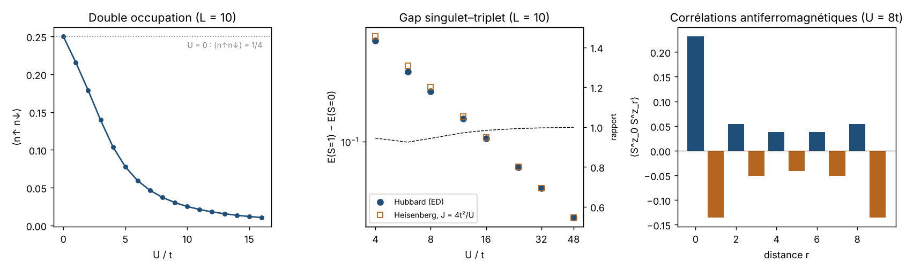

# 🔬 Modèle de Hubbard : transition de Mott par diagonalisation exacte

> Projet personnel : résoudre **exactement** le modèle de Hubbard 1D (jusqu'à 63 504 états), le comparer à la solution de Bethe (Lieb & Wu) et retrouver le magnétisme de Heisenberg avec **J = 4t²/U**.

  -informational)

## 🎯 Objectif

Le modèle de Hubbard est le modèle minimal des **électrons fortement corrélés** (oxydes de cuivre supraconducteurs, isolants de Mott) :

$$H = -t\sum_{\langle ij\rangle,\sigma}\left(c^\dagger_{i\sigma}c_{j\sigma}+\text{h.c.}\right) + U\sum_i n_{i\uparrow}n_{i\downarrow}$$

Le saut t veut délocaliser les électrons (métal) ; la répulsion U veut un électron par site (isolant). À demi-remplissage, que gagne-t-on ? Et pourquoi les spins s'ordonnent-ils de façon antiferromagnétique ?

## 📊 Résultats

| Validation | Résultat |
|---|---|
| U = 0 contre fermions libres | écart **7 × 10⁻¹⁵** |
| Énergie, L = 10, U = 4t, contre Bethe ansatz (L → ∞) | −0,5834 contre −0,5737 (**1,7 %**, effet de taille finie) |
| Hellmann–Feynman : ∂E/∂U = ⟨n↑n↓⟩ | 0,104085 = 0,104085 |
| Gap de spin Hubbard / Heisenberg (J = 4t²/U), U = 48t | rapport **0,998** |



> 💡 Le gap de charge reste ouvert pour tout U > 0 : en 1D, le demi-remplissage est **toujours** un isolant de Mott (Lieb & Wu). À petit U, le gap exact est exponentiellement petit et l'ED est dominée par la taille finie ; à grand U, il tend vers U − 4t.



À grand U, les doubles occupations disparaissent et seul reste le **spin** : un électron ne peut sauter chez son voisin que si les spins sont opposés (virtuellement, coût U), d'où un gain d'énergie −4t²/U pour une paire antiparallèle. C'est le **super-échange**, et l'ED le confirme quantitativement.

## 🏗 Architecture du projet

```
10-modele-hubbard-diagonalisation-exacte/
├── src/
│   ├── hubbard.py   # base en entiers binaires, signes fermioniques, H creux, Lanczos, Bethe ansatz, Heisenberg
│   └── analyse.py   # énergie, gaps, double occupation, corrélations, figures
├── tests/test_hubbard.py
├── figures/
├── resultats.json
└── README.md
```

## 🔧 Démarche, étape par étape

- **Étape 1 — Base.** Une configuration de spin σ est un entier dont les bits donnent l'occupation des sites. Comme N↑ et N↓ sont conservés : H = T↑ ⊗ 1 + 1 ⊗ T↓ + U·diag(doubles). Dimension pour L = 10 : C(10,5)² = 63 504.
- **Étape 2 — Signes fermioniques.** c†_a c_b donne (−1)^(nombre de fermions entre a et b). Vérifié contre des opérateurs de **Jordan-Wigner** construits explicitement (test).
- **Étape 3 — Lanczos.** Matrice creuse + `scipy.sparse.linalg.eigsh` : seul l'état fondamental est calculé.
- **Étape 4 — Validation.** Fermions libres (U = 0), dimère (solution analytique), Hellmann–Feynman, Bethe ansatz de Lieb & Wu pour l'énergie et le gap.
- **Étape 5 — Physique.** Gap de charge Δ_c = E(N+1) + E(N−1) − 2E(N), double occupation, corrélations ⟨S^z_0 S^z_r⟩, gap singulet–triplet comparé au modèle de Heisenberg diagonalisé lui aussi.

Tailles L = 6 et 10 (L = 4n + 2) : à U = 0 la couche est fermée, donc le fondamental n'est pas dégénéré.

## 💬 Pour l'expliquer en entretien

- **Pourquoi la diagonalisation exacte ?** C'est la seule méthode sans approximation : elle sert de **référence** pour tester DMFT, DMRG, Monte-Carlo quantique ou des modèles effectifs. Sa limite : la taille de l'espace de Hilbert croît exponentiellement (4^L).
- **Isolant de Mott ou de bande ?** Une bande à moitié pleine devrait être métallique ; ici c'est la répulsion U qui bloque le transport. Le gap est un effet à N corps, invisible en théorie des bandes.
- **D'où vient J = 4t²/U ?** Perturbation au second ordre en t/U : un saut virtuel vers un état doublement occupé (énergie U) puis retour.
- **Lien avec les oxydes réels (CuO, cuprates) :** on passe à un modèle à plusieurs orbitales (Cu 3d, O 2p, modèle d'Emery), avec un gap de transfert de charge. Ce projet en est la brique de base.

## 🚀 Installation et lancement

```bash
pip install -r requirements.txt
cd projets/10-modele-hubbard-diagonalisation-exacte
python src/analyse.py                 # ~40 s
python -m pytest tests
```

**Références :** E. H. Lieb, F. Y. Wu, *Phys. Rev. Lett.* 20, 1445 (1968) · A. A. Ovchinnikov, *Sov. Phys. JETP* 30, 1160 (1970) · F. H. L. Essler *et al.*, *The One-Dimensional Hubbard Model*, Cambridge (2005).
