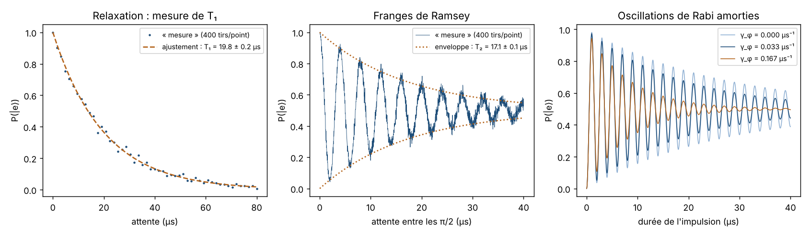
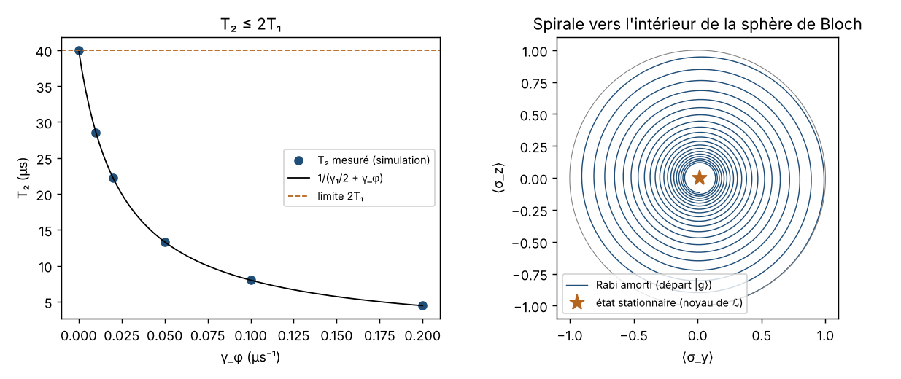

# ⚛️ Décohérence d'un qubit : équation de Lindblad

> Prolonge mon cours de M2 *Intrication et décohérence* : simuler un qubit ouvert avec un solveur de Lindblad écrit moi-même, puis « mesurer » T₁ et T₂ comme dans un laboratoire de qubits.

  

## 🎯 Objectif

Un qubit réel n'est jamais isolé. Son couplage à l'environnement se résume, dans l'approximation de Born-Markov, par l'équation maîtresse de **Lindblad** :

$$\dot\rho = -i[H,\rho] + \sum_k \left(L_k\rho L_k^\dagger - \tfrac12\{L_k^\dagger L_k,\rho\}\right)$$

avec deux canaux : la **relaxation** (L = √γ₁ σ₋, temps T₁) et le **déphasage pur** (L = √(γ_φ/2) σ_z). La cohérence décroît alors en T₂ = 1/(γ₁/2 + γ_φ) ≤ 2T₁. L'objectif est de simuler les trois expériences de base de tout laboratoire de qubits et d'en extraire T₁ et T₂ **par ajustement**, avec le bruit de projection d'une vraie mesure.

## 📊 Résultats

| Grandeur | Valeur injectée | Valeur extraite (400 tirs par point) |
|---|---|---|
| T₁ (relaxation) | 20 µs | **19,8 ± 0,2 µs** |
| T₂ (franges de Ramsey) | 17,14 µs | **17,14 ± 0,09 µs** |
| Désaccord de Ramsey | 250 kHz | 250,06 kHz |
| Population stationnaire sous excitation | Bloch analytique : 0,499852 | Lindblad : 0,499852 |





## 🏗 Architecture du projet

```
11-qubit-decoherence-lindblad/
├── src/
│   ├── lindblad.py   # H, opérateurs de saut, Lindbladien, RK4, vecteur de Bloch, état stationnaire
│   └── analyse.py    # protocoles T1, Ramsey, Rabi, balayage T2(γ_φ), figures
├── tests/test_lindblad.py
├── figures/
├── resultats.json
└── README.md
```

## 🔧 Démarche, étape par étape

- **Étape 1 — Solveur.** Lindbladien codé à la main, intégré en Runge-Kutta 4 (pas 2–20 ns). Pas de boîte noire (QuTiP) : on contrôle chaque terme.
- **Étape 2 — Validation.** Sans dissipation, P_e(t) = sin²(Ωt/2) exactement ; décroissances T₁ et T₂ analytiques ; trace = 1, ρ hermitienne et positive à tout instant.
- **Étape 3 — État stationnaire.** On vectorise ρ, on écrit le superopérateur ℒ (matrice 4 × 4) et on cherche son noyau ; comparaison avec les **équations de Bloch optiques** : ρ_ee = ½ s/(1+s), s = Ω²T₁T₂/(1+Δ²T₂²).
- **Étape 4 — Protocoles de labo.** T₁ : préparer |e⟩ et attendre. Ramsey : π/2 – attente – π/2 avec un désaccord. Rabi : impulsion de durée variable. Chaque point est « mesuré » avec un nombre fini de tirs (loi binomiale), puis ajusté.

## 💬 Pour l'expliquer en entretien

- **Pourquoi T₂ ≤ 2T₁ ?** La relaxation détruit aussi la cohérence (à la moitié de son taux) ; le déphasage pur ne peut que s'y ajouter.
- **Ramsey contre écho de spin :** Ramsey mesure T₂\*, sensible aux fluctuations lentes ; une impulsion π au milieu (écho de Hahn) les refocalise. Extension naturelle de ce code.
- **Lien avec les plateformes réelles :** qubits supraconducteurs (T₁ ~ 10–300 µs), ions piégés et atomes neutres (T₂ jusqu'à la seconde), qubits de chat (Alice & Bob), où la dissipation à deux photons est **utilisée** pour stabiliser le qubit.
- **Limite :** approximation markovienne (bruit blanc) ; un bruit en 1/f demanderait une décroissance non exponentielle.

## 🚀 Installation et lancement

```bash
pip install -r requirements.txt
cd projets/11-qubit-decoherence-lindblad
python src/analyse.py                 # ~10 s
python -m pytest tests
```

**Références :** G. Lindblad, *Commun. Math. Phys.* 48, 119 (1976) · S. Haroche, J.-M. Raimond, *Exploring the Quantum*, Oxford (2006) · P. Krantz *et al.*, *Appl. Phys. Rev.* 6, 021318 (2019).
