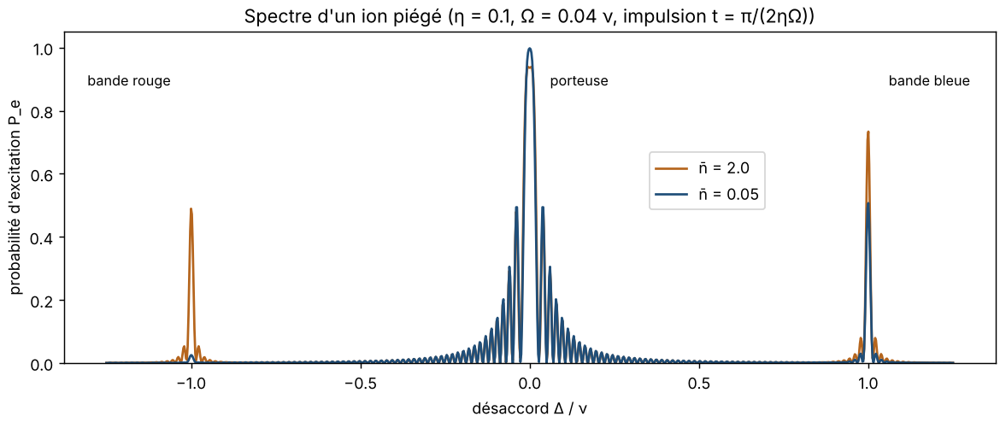
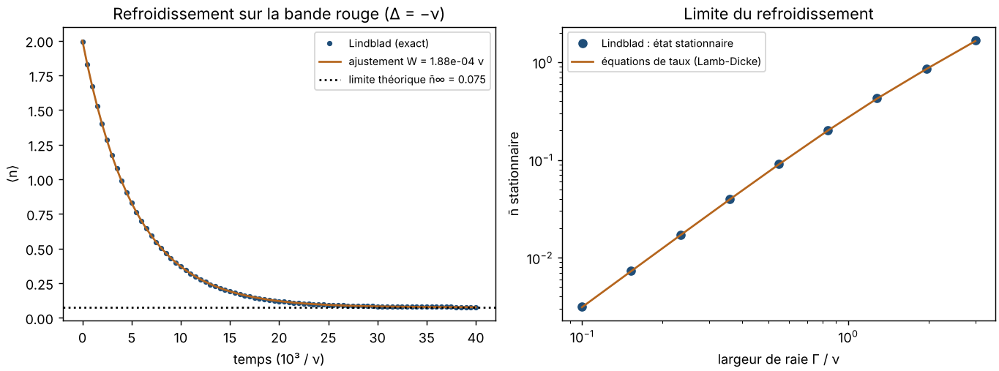
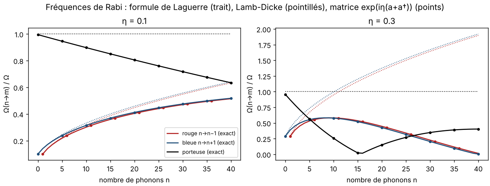

# 🪤 Ion piégé : bandes latérales, thermométrie et refroidissement laser

> En lien avec les stages de M2 que je vise sur les ions piégés refroidis par laser : simuler le couplage entre le qubit optique d'un ion et son mouvement dans le piège, puis le refroidir jusqu'à l'état fondamental, avec un solveur de Lindblad écrit moi-même.

  

## 🎯 Objectif

Un ion piégé est un atome à deux niveaux (|g⟩, |e⟩) qui oscille dans un puits harmonique de fréquence ν. Le laser qui adresse le qubit communique aussi une impulsion : il couple les niveaux internes au mouvement. Dans le référentiel du laser (ħ = 1) :

$$H = \nu\, a^\dagger a - \frac{\Delta}{2}\sigma_z + \frac{\Omega}{2}\left[\sigma_+ e^{i\eta(a+a^\dagger)} + \text{h.c.}\right]$$

où η est le paramètre de Lamb-Dicke. Trois raies apparaissent : la **porteuse** (Δ = 0), la **bande rouge** (Δ = −ν, |g, n⟩ → |e, n−1⟩, un phonon est retiré) et la **bande bleue** (Δ = +ν, un phonon est ajouté). Ce sont les outils de base de tout laboratoire d'ions piégés : ils servent à mesurer la température, à refroidir et à réaliser des portes à deux qubits. Pour le refroidissement, on ajoute l'émission spontanée (taux Γ) avec le recul du photon émis, L_± = √(Γ/2) σ₋ e^(±iη(a+a†)).

## 📊 Résultats

| Grandeur | Simulation exacte | Référence analytique |
|---|---|---|
| Couplages Ω(n→m), η = 0,3 | élément de matrice de e^(iη(a+a†)) | formule de Laguerre : écart **6 × 10⁻¹⁵** |
| Rupture de Lamb-Dicke (n = 20, η = 0,3) | Ω(20→19) = **0,33 ×** la valeur η√n | régime η√n ≪ 1 non vérifié |
| Thermométrie par bandes latérales | n̄ mesuré = 0,302 ; 1,002 ; 2,002 ; 5,004 | n̄ vrai = 0,3 ; 1 ; 2 ; 5 |
| Taux de refroidissement (Ω = 0,1ν, Γ = 0,5ν) | W = (1,876 ± 0,002) × 10⁻⁴ ν | équations de taux : 1,97 × 10⁻⁴ ν (−5 %) |
| Limite du refroidissement n̄∞ | ajustement : 0,0751 | équations de taux : 0,0754 |
| n̄∞ en fonction de Γ (9 valeurs, 0,1 à 3ν) | état stationnaire de ℒ | écart ≤ **1,7 %** ; pente log-log 1,99 (théorie 2) |



La bande rouge disparaît quand l'ion est dans son état fondamental (n̄ = 0,05) : |g, 0⟩ n'a pas de phonon à céder. Cette asymétrie rouge/bleu est la signature expérimentale du refroidissement à l'état fondamental.





## 🏗 Architecture du projet

```
12-ion-piege-bandes-laterales/
├── src/
│   ├── ion.py       # H, couplages de Laguerre, spectre, liouvillien creux, état stationnaire, équations de taux
│   └── analyse.py   # figures et resultats.json
├── tests/test_ion.py
├── figures/
├── resultats.json
└── README.md
```

## 🔧 Démarche, étape par étape

- **Étape 1 — Couplages.** On construit e^(iη(a+a†)) dans un espace de Fock élargi puis tronqué, et on compare chaque élément à la formule fermée Ω(n→m)/Ω = e^(−η²/2) η^|m−n| √(n<!/n>!) L_{n<}^{|m−n|}(η²). On montre où l'approximation de Lamb-Dicke (η√n) cesse de valoir : à η = 0,3 la bande rouge s'annule près de n = 40.
- **Étape 2 — Spectre.** Évolution unitaire exacte de l'ion (diagonalisation de H, dimension 2N) pour chaque désaccord, moyennée sur une distribution thermique de phonons.
- **Étape 3 — Thermométrie.** Pour un état thermique, p_{n+1}/p_n = n̄/(n̄+1) et Ω(n+1→n) = Ω(n→n+1) : le rapport des excitations rouge/bleu vaut exactement n̄/(n̄+1), quelle que soit la durée d'impulsion. La simulation le confirme à moins de 1 % près pour n̄ ≥ 0,3, l'erreur venant de l'excitation hors résonance de la porteuse (5 % à n̄ = 0,05).
- **Étape 4 — Refroidissement.** Liouvillien vectorisé (dimension (2N)²) : l'état stationnaire est le noyau de ℒ (avec Tr ρ = 1), et la dynamique est obtenue par diagonalisation de ℒ, ce qui donne ρ(t) à tout instant sans intégration pas à pas sur 4 × 10⁴ périodes. On compare aux équations de taux de Lamb-Dicke : A∓ = η²[R(Δ ± ν) + R(Δ)], avec R(δ) = Ω²Γ/(Γ² + 4δ²), puis n̄∞ = A₊/(A₋ − A₊).

## 💬 Pour l'expliquer en entretien

- **Pourquoi n̄∞ ∝ Γ² ?** Sur la bande rouge, le chauffage vient de l'excitation hors résonance de la porteuse et de la bande bleue, dont le poids relatif est ≈ (Γ/2ν)² : il faut une raie étroite (Γ ≪ ν, « régime résolu »).
- **Ce qui limite le taux W :** W ≈ η²Ω²/Γ. Augmenter Ω accélère le refroidissement mais élargit la raie par saturation ; c'est l'écart de 5 % observé à Ω = 0,1ν.
- **Lien avec les expériences :** refroidissement Doppler puis par bande latérale (Ca⁺, Be⁺, Yb⁺), thermométrie par asymétrie rouge/bleu, portes de Mølmer-Sørensen qui utilisent les deux bandes à la fois.
- **Limites :** un seul mode de mouvement, recul seulement le long de l'axe (facteur angulaire 1), pas de structure fine ni de repompage, pas de chauffage du piège par bruit électrique.

## 🚀 Installation et lancement

```bash
pip install -r requirements.txt
cd projets/12-ion-piege-bandes-laterales
python src/analyse.py                 # ~15 s
python -m pytest tests
```

**Références :** D. J. Wineland *et al.*, *J. Res. NIST* **103**, 259 (1998) · D. Leibfried, R. Blatt, C. Monroe, D. Wineland, *Rev. Mod. Phys.* **75**, 281 (2003) · J. Eschner *et al.*, *J. Opt. Soc. Am. B* **20**, 1003 (2003).
